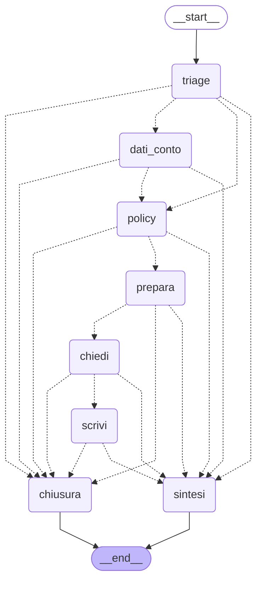

# lipari-bank-ai

L'assistente AI di LipariBank per gli operatori di filiale: un servizio FastAPI su Postgres con pgvector, con un RAG sulle policy della banca filtrato per ruolo, un agente con cinque tool legati all'operatore che chiede, una sosta per l'approvazione di un responsabile prima di una segnalazione alla Compliance sopra soglia, un server MCP, e un harness che misura le risposte.

## Avvio

Servono Docker e [uv](https://docs.astral.sh/uv/). Python 3.12 lo installa uv.

```bash
# 1. Postgres con pgvector, e il database dei test
docker run -d --name lipari-pg -e POSTGRES_USER=lipari -e POSTGRES_PASSWORD=lipari \
  -e POSTGRES_DB=lipari_ai -p 5432:5432 pgvector/pgvector:pg16
docker exec lipari-pg psql -U lipari -d lipari_ai -c "create database lipari_ai_test"

# 2. la configurazione: copia l'esempio e compila i valori che elenca
cp .env.example .env

# 3. dipendenze, schema, dati di sviluppo
uv sync
uv run alembic upgrade head
uv run python -m scripts.seed_users
uv run python -m scripts.seed_accounts

# 4. il servizio, e la sonda
uv run uvicorn src.main:app --port 8000
curl -s localhost:8000/health        # "status":"UP"

# 5. da un secondo terminale, col servizio acceso: i documenti nell'indice
uv run python -m scripts.ingest_docs
```

Il caricamento dei documenti calcola gli embedding con il modello configurato, quindi chiede la chiave API nel `.env`. La password degli utenti di sviluppo non sta nel codice: sta nel `.env` (`SEED_PASSWORD`, almeno 12 caratteri), e vale solo sulla tua macchina; `uv run python -m scripts.seed_users --ruota` la riscrive su chi c'è già.

## Test e controlli

```bash
uv run pytest -q          # sul database lipari_ai_test
uv run mypy .
uv run ruff check . && uv run ruff format --check .
uv run python -m evals.runner        # l'harness: chiama il modello vero, e costa
uv run python -m evals.confronto     # le quattro implementazioni sulle stesse traiettorie
uv run python -m scripts.disegna_grafo   # il grafo del supervisor, disegnato dal suo codice
```

I test non chiamano nessun modello: usano i finti di `tests/finti.py`.

## Dove sono le cose

| Cartella | Cosa |
|---|---|
| `src/api/` | gli endpoint: chat, consulenza sulle policy, agente, conti, movimenti, autenticazione |
| `src/agents/` | il ciclo dell'agente scritto a mano, i tool, la sosta per l'approvazione, il supervisor, il client MCP |
| `src/lg/` | il supervisor come grafo LangGraph: lo stato, la tabella dei percorsi, il checkpointer di Postgres |
| `src/services/` | retrieval con i permessi, RAG con le citazioni, ingestione, categorizzazione |
| `scripts/` | seed, ingestione dei documenti, disegno del grafo |
| `docs/` | il disegno del grafo (`grafo.md`), generato dal codice |
| `liparibank_mcp/` | il server MCP, che verifica l'identità da un token firmato |
| `evals/` | l'harness, i casi in `datasets/`, il cancello con le soglie |
| `data/docs/` | il corpus: le sottocartelle dicono chi può leggere (`compliance_only/`) |

## Il grafo del supervisor

Il supervisor — chi lavora su una domanda, con quali tool e in che ordine — è un grafo
LangGraph in `src/lg/`: la tabella `PERCORSI` dichiara il flusso, `instrada` lo segue mettendo
i tetti prima di tutto, e la sosta per l'approvazione è un `interrupt()` appoggiato a Postgres.
Non l'ho disegnato a mano: nodi e collegamenti vengono dal grafo compilato, e
`uv run python -m scripts.disegna_grafo` li ritrae in `docs/grafo.md` (Mermaid sotto, tabella
dei percorsi nel file). La spiegazione passo passo è in [`spiegazione_grafo.md`](spiegazione_grafo.md).



Quando l'importo di una segnalazione supera la soglia, `chiedi` chiama `interrupt()`: il grafo
si ferma lì, e ad aspettare è il **thread** nel checkpointer
(`checkpointer_postgres()` in `src/lg/grafo.py`, un `AsyncPostgresSaver` per richiesta). Il
thread è `f"{username}:{uuid4()}"`, generato server-side, quindi due run non possono
incrociarsi: non condividono niente. Le quattro tabelle del checkpointer sono fuori dalle
migration (`fuori_dalle_migration` in `alembic/env.py`): `revision --autogenerate` non deve
proporsi di cancellarle, e con le soste che contengono.

Il motore HTTP (`/api/ai/agent`) continua a girare sul ciclo scritto a mano
(`src/agents/loop.py`): il grafo è la quarta implementazione dello stesso comportamento,
misurata dalle eval insieme alle altre tre e coperta dai suoi test.

## Scoperta

Il server pubblicato (`uv run python -m liparibank_mcp.pubblico`, porta 8200) rifiuta chi non
porta un token emesso per lui. Senza token, la risposta è un 401 che punta ai metadati OAuth
del server; i metadati, a quel punto, dicono dove si prende il token e quali scope il server
riconosce:

```text
$ curl.exe -si http://127.0.0.1:8200/mcp
HTTP/1.1 401 Unauthorized
date: Thu, 15 Oct 2026 08:10:48 GMT
server: uvicorn
content-length: 0
www-authenticate: Bearer resource_metadata="http://127.0.0.1:8200/.well-known/oauth-protected-resource/mcp"

$ curl.exe -s http://127.0.0.1:8200/.well-known/oauth-protected-resource/mcp
{"resource":"http://127.0.0.1:8200/mcp","authorization_servers":["http://127.0.0.1:8000/"],"scopes_supported":["conti:leggi","policy:leggi"],"bearer_methods_supported":["header"],"resource_name":"LipariBank, conti e procedure"}
```

Con un token non valido, fastmcp risponde 401 e nel messaggio suggerisce di «ri-registrarsi»
e ottenere nuovi token — parla della registrazione dinamica OAuth, che questo server **non
offre**: il client si registra solo in `CLIENTI` (in `src/auth/mcp_tokens.py`), scambia il
token via `POST /api/auth/token-mcp` sulla API a 8000, e quel token (audience `…/mcp`, 10
minuti) è l'unico che entra:

```text
$ curl.exe -si -X POST http://127.0.0.1:8200/mcp -H "Content-Type: application/json" ^
    -H "Accept: application/json, text/event-stream" ^
    -H "Authorization: Bearer token-non-valido" ^
    -d "{\"jsonrpc\":\"2.0\",\"id\":1,\"method\":\"initialize\",...}"
HTTP/1.1 401 Unauthorized
www-authenticate: Bearer error="invalid_token", error_description="Authentication failed. The provided bearer token is invalid, expired, or no longer recognized by the server. To resolve: clear authentication tokens in your MCP client and reconnect. Your client should automatically re-register and obtain new tokens.", resource_metadata="http://127.0.0.1:8200/.well-known/oauth-protected-resource/mcp"

{"error": "invalid_token", "error_description": "Authentication failed. The provided bearer token is invalid, expired, or no longer recognized by the server. To resolve: clear authentication tokens in your MCP client and reconnect. Your client should automatically re-register and obtain new tokens."}
```

## Misure

### Superficie pubblicata — 15/10/2026

`uv run python -m evals.superficie`: il server vero, su HTTP nello stesso processo; per ogni
coppia client-ruolo emette il token come farebbe lo scambio e legge i tool che il server
mostra. È la tabella che un auditor legge: esce dal sistema, non da un documento.

```text
client | ruolo | tool visti | che scrivono | agente A2A
agente-compliance | compliance_lead | nessuno | 0 | sì
agente-compliance | operator | nessuno | 0 | sì
agente-compliance | risk_lead | nessuno | 0 | no
assistente-filiale | compliance_lead | search_policy v2/1 | 0 | sì
assistente-filiale | operator | find_customer_accounts, get_account_balance, search_policy v2/1 | 0 | sì
assistente-filiale | risk_lead | search_policy v2/1 | 0 | no
supporto-procedure | compliance_lead | search_policy v2/1 | 0 | no
supporto-procedure | operator | search_policy v2/1 | 0 | no
supporto-procedure | risk_lead | search_policy v2/1 | 0 | no
coppie client-ruolo: 9 · tool esposti in tutto: 8
```

Il muro del portafoglio e quello dei documenti valgono anche da fuori: `find_customer_accounts`
e `get_account_balance` esistono solo per chi ha `conti:leggi` (assistente-filiale, ruolo
operator), e il retrieval filtrato per ruolo vale anche sul tool pubblicato.

### Dopo l'estensione (strada C) — 15/10/2026

Stesso comando, stesso server, dopo aver affiancato alla v1 di `find_customer_accounts` una v2
con un cambio che rompe (testo → JSON), con data di disdetta della v1 nel registry.

```text
client | ruolo | tool visti | che scrivono | agente A2A
agente-compliance | compliance_lead | nessuno | 0 | sì
agente-compliance | operator | nessuno | 0 | sì
agente-compliance | risk_lead | nessuno | 0 | no
assistente-filiale | compliance_lead | search_policy v2/1 | 0 | sì
assistente-filiale | operator | find_customer_accounts v2/1, get_account_balance, search_policy v2/1 | 0 | sì
assistente-filiale | risk_lead | search_policy v2/1 | 0 | no
supporto-procedure | compliance_lead | search_policy v2/1 | 0 | no
supporto-procedure | operator | search_policy v2/1 | 0 | no
supporto-procedure | risk_lead | search_policy v2/1 | 0 | no
coppie client-ruolo: 9 · tool esposti in tutto: 8
```

### Delta superficie (prima → dopo, 15/10/2026)

| client | ruolo | prima | dopo | perché |
|---|---|---|---|---|
| assistente-filiale | operator | `find_customer_accounts` | `find_customer_accounts v2/1` | il tool ora serve due versioni: la 1 (testo, con disdetta) e la 2 (JSON). Nessun client o ruolo nuovo vede un tool nuovo: la superficie non cresce, cambia solo la dicitura delle versioni sotto lo stesso nome. |

Il totale resta 8 e le coppie restano 9: la strada C non aggiunge superficie, aggiunge una
versione. La riga che un auditor legge cambia in una sola cella, e la voce di registry
(`registry/server.json`) dichiara quali versioni si servono e fino a quando la 1
(`disdette.find_customer_accounts.1 = "2026-11-15"`).

### Eval confronto — 08/10/2026

Le due esecuzioni di `uv run python -m evals.confronto`, entrambe dopo
`uv run python -m scripts.ingest_docs` (6 documenti in `data/docs/`, 9 casi in
`evals/datasets/agent_traiettorie.jsonl`). «ricerche» = `search_documents` eseguite per caso;
il costo è quello misurato per caso dall'harness.

### Prima — casi nuovi presenti, tetto assente

```text
== ciclo
traiettorie  0.78 (7/9)  soglia 0.80  SOTTO SOGLIA  costo EUR 0.0036
    x traj-003: {"violati": ["citazione"], "tool_chiamati": ["search_documents"], "passi": 3, "stopped_by": "model", "costo_eur": "0.000562"}
    x traj-006: {"violati": ["risposta_contiene"], "tool_chiamati": ["search_documents"], "passi": 3, "stopped_by": "model", "costo_eur": "0.000609"}
  traj-001                 0 ricerche  0.000320 EUR
  traj-002                 0 ricerche  0.000210 EUR
  traj-003                 2 ricerche  0.000562 EUR
  traj-004                 0 ricerche  0.000141 EUR
  traj-005                 0 ricerche  0.000113 EUR
  traj-006                 2 ricerche  0.000609 EUR
  traj-007                 1 ricerche  0.000293 EUR
  traj-008                 1 ricerche  0.000275 EUR
  traj-009                 5 ricerche  0.001095 EUR

== catena
traiettorie  0.22 (2/9)  soglia 0.80  SOTTO SOGLIA  costo EUR 0.0012
    x traj-001: {"violati": ["tool_richiesti"], "tool_chiamati": ["search_documents"], "passi": 1, "stopped_by": "model", "costo_eur": "0.000101"}
    x traj-002: {"violati": ["tool_richiesti"], "tool_chiamati": ["search_documents"], "passi": 1, "stopped_by": "model", "costo_eur": "0.000112"}
    x traj-003: {"violati": ["citazione"], "tool_chiamati": ["search_documents"], "passi": 1, "stopped_by": "model", "costo_eur": "0.000098"}
    x traj-004: {"violati": ["tool_richiesti", "terminazione"], "tool_chiamati": ["search_documents"], "passi": 1, "stopped_by": "model", "costo_eur": "0.000239"}
    x traj-005: {"violati": ["tool_vietati"], "tool_chiamati": ["search_documents"], "passi": 1, "stopped_by": "model", "costo_eur": "0.000082"}
    ... e altri 2: traj-006, traj-007
  traj-001                 1 ricerche  0.000101 EUR
  traj-002                 1 ricerche  0.000112 EUR
  traj-003                 1 ricerche  0.000098 EUR
  traj-004                 1 ricerche  0.000239 EUR
  traj-005                 1 ricerche  0.000082 EUR
  traj-006                 1 ricerche  0.000147 EUR
  traj-007                 1 ricerche  0.000136 EUR
  traj-008                 1 ricerche  0.000155 EUR
  traj-009                 1 ricerche  0.000114 EUR

== agente
traiettorie  0.78 (7/9)  soglia 0.80  SOTTO SOGLIA  costo EUR 0.0038
    x traj-003: {"violati": ["citazione"], "tool_chiamati": ["search_documents"], "passi": 2, "stopped_by": "model", "costo_eur": "0.000291"}
    x traj-009: {"violati": ["passi"], "tool_chiamati": ["search_documents"], "passi": 8, "stopped_by": "model", "costo_eur": "0.001791"}
  traj-001                 0 ricerche  0.000319 EUR
  traj-002                 0 ricerche  0.000212 EUR
  traj-003                 1 ricerche  0.000291 EUR
  traj-004                 0 ricerche  0.000151 EUR
  traj-005                 0 ricerche  0.000117 EUR
  traj-006                 1 ricerche  0.000317 EUR
  traj-007                 1 ricerche  0.000345 EUR
  traj-008                 1 ricerche  0.000286 EUR
  traj-009                 7 ricerche  0.001791 EUR
```

### Dopo — tetto attivo (`ToolCallLimitMiddleware` su `search_documents`, `thread_limit=3`, `exit_behavior="continue"`)

```text
== ciclo
traiettorie  0.78 (7/9)  soglia 0.80  SOTTO SOGLIA  costo EUR 0.0024
    x traj-003: {"violati": ["citazione"], "tool_chiamati": ["search_documents"], "passi": 2, "stopped_by": "model", "costo_eur": "0.000262"}
    x traj-008: {"violati": ["risposta_contiene"], "tool_chiamati": ["search_documents"], "passi": 2, "stopped_by": "model", "costo_eur": "0.000279"}
  traj-001                 0 ricerche  0.000315 EUR
  traj-002                 0 ricerche  0.000204 EUR
  traj-003                 1 ricerche  0.000262 EUR
  traj-004                 0 ricerche  0.000170 EUR
  traj-005                 0 ricerche  0.000105 EUR
  traj-006                 1 ricerche  0.000300 EUR
  traj-007                 1 ricerche  0.000278 EUR
  traj-008                 1 ricerche  0.000279 EUR
  traj-009                 2 ricerche  0.000511 EUR

== catena
traiettorie  0.22 (2/9)  soglia 0.80  SOTTO SOGLIA  costo EUR 0.0012
    x traj-001: {"violati": ["tool_richiesti"], "tool_chiamati": ["search_documents"], "passi": 1, "stopped_by": "model", "costo_eur": "0.000101"}
    x traj-002: {"violati": ["tool_richiesti"], "tool_chiamati": ["search_documents"], "passi": 1, "stopped_by": "model", "costo_eur": "0.000112"}
    x traj-003: {"violati": ["citazione"], "tool_chiamati": ["search_documents"], "passi": 1, "stopped_by": "model", "costo_eur": "0.000098"}
    x traj-004: {"violati": ["tool_richiesti", "terminazione"], "tool_chiamati": ["search_documents"], "passi": 1, "stopped_by": "model", "costo_eur": "0.000275"}
    x traj-005: {"violati": ["tool_vietati"], "tool_chiamati": ["search_documents"], "passi": 1, "stopped_by": "model", "costo_eur": "0.000082"}
    ... e altri 2: traj-006, traj-007
  traj-001                 1 ricerche  0.000101 EUR
  traj-002                 1 ricerche  0.000112 EUR
  traj-003                 1 ricerche  0.000098 EUR
  traj-004                 1 ricerche  0.000275 EUR
  traj-005                 1 ricerche  0.000082 EUR
  traj-006                 1 ricerche  0.000133 EUR
  traj-007                 1 ricerche  0.000136 EUR
  traj-008                 1 ricerche  0.000158 EUR
  traj-009                 1 ricerche  0.000114 EUR

== agente
traiettorie  0.89 (8/9)  soglia 0.80  ok            costo EUR 0.0027
    x traj-003: {"violati": ["citazione"], "tool_chiamati": ["search_documents"], "passi": 2, "stopped_by": "model", "costo_eur": "0.000291"}
  traj-001                 0 ricerche  0.000309 EUR
  traj-002                 0 ricerche  0.000199 EUR
  traj-003                 1 ricerche  0.000291 EUR
  traj-004                 0 ricerche  0.000147 EUR
  traj-005                 0 ricerche  0.000117 EUR
  traj-006                 1 ricerche  0.000334 EUR
  traj-007                 1 ricerche  0.000326 EUR
  traj-008                 1 ricerche  0.000291 EUR
  traj-009                 3 ricerche  0.000680 EUR
```

### Delta (08/10/2026, «prima» → «dopo»)

| gruppo (casi) | catena: ricerche | catena: EUR | agente: ricerche | agente: EUR |
|---|---|---|---|---|
| un passo (traj-001…005) | 5, uno per caso, fisso | 0.000632 → 0.000668 | 1 → 1 | 0.001090 → 0.001063 |
| multi-hop (traj-006…008) | 3, uno per caso, fisso | 0.000438 → 0.000427 | 3 → 3 | 0.000948 → 0.000951 |
| senza risposta (traj-009) | 1 → 1 | 0.000114 → 0.000114 | **7 → 3** | 0.001791 → 0.000680 |
| totale ricerche | 9 → 9 | | **11 → 7** | |

- **Casi a un passo: la catena resta più economica, e il numero lo mostra**: 0.000632 EUR
  (prima) contro 0.001090 dell'agente sui cinque casi, pur con una ricerca fissa per caso
  (l'agente ne fa una sola in tutto il gruppo). Anche «dopo» il divario c'è: 0.000668 contro
  0.001063.
- **Multi-hop**: l'agente supera 3 casi su 3 in entrambe le esecuzioni, la catena 1 su 3
  (solo traj-008); i costi per caso non cambiano con il tetto (1 ricerca a caso in tutte e due).
- **Senza risposta (traj-009)**: è l'unico punto dove il tetto si vede. L'agente prima 7 ricerche
  e 8 passi (fallito sul controllo `passi`), dopo 3 ricerche sotto il tetto, terminazione
  `model`: il caso passa e scende da 0.001791 a 0.000680 EUR.
- **Punteggi**: catena 0.22 → 0.22 (sotto soglia 0.80 in entrambe), agente 0.78 → 0.89 (sopra
  soglia da «dopo»), ciclo 0.78 → 0.78.
- `catena` e `ciclo` non passano dal middleware: fra le due esecuzioni i loro numeri cambiano
  solo per il modello non deterministico (la ricerca della catena resta una, il costo dei casi
  a un passo oscilla di poche unità alla quinta cifra).
- Un fallimento che non c'entra col tetto: traj-003 non supera `citazione` in nessuna delle
  due esecuzioni.

### Col grafo — 12/10/2026

Stesso dataset (9 casi), stesso modello, stessa macchina: `uv run python -m evals.confronto`
con le quattro implementazioni, il grafo compreso. «ricerche» = `search_documents` eseguite su
tutta la serie.

| implementazione | punteggio | sopra soglia 0.80 | costo totale EUR | ricerche |
|---|---|---|---|---|
| ciclo (a mano) | 0.89 (8/9) | sì | 0.0024 | 6 |
| catena | 0.22 (2/9) | no | 0.0012 | 9 |
| agente prebuilt | 0.89 (8/9) | sì | 0.0026 | 7 |
| grafo | 0.33 (3/9) | no | 0.0045 | 6 |

- Il grafo paga il suo ordine: il triage e la sintesi sono chiamate vere che il ciclo non ha,
  e i `passi_max` del dataset (1–6) sono tarati sul ciclo. Nei casi a un salto il
  sovrapprezzo strutturale basta a farlo uscire su `passi` (5–6 chiamate contro 3–4), mentre
  passa i tre casi multi-hop col budget più largo (traj-006, 008, 009). È lo stesso
  comportamento che il banco di `tests/test_g2_langgraph.py` fissa con il modello fintto:
  1 sui tre casi del Giorno 1, con `passi` violato su saldo e segnalazione.
- Un fallimento di natura diversa: su traj-004 (la segnalazione da approvare) il triage ha
  scelto un'altra strada e la sosta non è partita — `tool_richiesti` e `terminazione` violati.
  Sul modello vero il triage è non deterministico; nel test la risposta è un copione.
- La catena resta la più economica e la meno giusta: 9 ricerche fisse e 7 casi falliti.
- L'ordine di costo fra ciclo e agente lo decide il modello non deterministico, non
  l'architettura: fra 0.0024 e 0.0026 EUR su nove casi. Quello che questi numeri dicono con
  certezza è il punteggio e quante ricerche servono.
- Il per-caso lo stampa lo stesso comando; le soglie del cancello sono in `evals/runner.py`.

## Strada C — Una versione che rompe

### Il comando

```bash
uv run pytest tests/test_g4_strada_c.py -q
```

### Le tre righe del criterio 4

1. La v2 di `find_customer_accounts` cambia la forma della risposta sotto lo stesso nome (testo →
   JSON), e la v1 resta servita: `test_le_due_versioni_di_find_customer_accounts_convivono`
   chiama la 1 e la 2 e vede due forme diverse; se togli la registrazione della v1, il
   `version="1"` non trova più niente e il test cade.
2. Chi non sceglie la versione prende la più alta (la 2, JSON) e il client che parsava il testo
   si rompe: `test_senza_versione_arriva_la_piu_alta_e_questo_rompe_il_vecchio` fissa questo
   comportamento di default ed è il motivo per cui la v1 ha una data di disdetta.
3. La voce di registry dichiara `versioni_servite.find_customer_accounts = ["2", "1"]` e
   `disdette.find_customer_accounts.1 = "2026-11-15"`; `test_la_disdetta_registrata_corrisponde_al_server_vivo`
   legge `come_e_fatto` dal server vivo e si accorge se la voce mente.

### 🧠 Prima di cominciare

**La strada scelta: C — Una versione che rompe.** Ho scelto C perché è la sola delle quattro
che si misura interamente con test deterministici e nessuna dipendenza esterna: la A chiede un
host di terze parti vero e la chiave dell'embedding per far rispondere il modello; la B
richiede un 403 scritto a mano in HTTP, lo scope di step-up nello scambio e l'integrazione col
blocco dell'approvazione, tre trappole insieme; la D tocca callback autenticate, protezione
SSRF e persistenza del task oltre un processo. Con i modelli locali che già usiamo (finti di
`tests/finti.py`), la C gira senza chiavi API e senza servizi esterni.

**La misura che uso:** la superficie di `evals/superficie.py` prima e dopo (il delta è una
cella: `find_customer_accounts` → `find_customer_accounts v2/1`), più la data di disdetta
della v1 nella voce di registry come numero della convivenza (fino al 2026-11-15).

**La trappola trovata e come l'ho aggirata:** volevo far restituire alla v2 un modello
Pydantic strutturato, ma il client fastmcp cerca lo schema di output per nome (non nome+versione)
e con due forme sotto lo stesso nome valida la risposta della v1 contro lo schema della v2:
la convivenza si rompeva a livello di client, non di server. La soluzione è che entrambe le
versioni restituiscano una stringa: la rottura sta nel contenuto (testo vs documento JSON),
non nel tipo di output, e la convivenza regge per i client fastmcp come per quelli che leggono
il testo.

## Revisione del codice scritto con l'AI

Riaperto il codice della strada C con le quattro domande della revisione:

- **Un token che vale troppo.** Il token MCP emesso per la v2 ha la stessa audience, lo stesso
  `azp` e la stessa durata (10 minuti) di quello della v1: la nuova versione non aggiunge scope
  (`conti:leggi` già presente) né allunga la scadenza. Non finisce in file, log o stati: i test
  lo generano in memoria e lo buttano.
- **Un'identità che non viene dal token.** La v2 chiama `identita()`, che legge `sub` e `role`
  dal token già verificato dal transport, e passa `utente.username` a `of_customer`: non c'è
  nessun punto in cui l'identità arrivi da un parametro del corpo o da un default.
- **Un contratto cambiato in silenzio.** Il cambio di forma è dichiarato: la v2 è una nuova
  registrazione con `version="2"`, la v1 resta con `version="1"`, e la voce di registry elenca
  entrambe con la data di disdetta. Nessuna descrizione o forma è cambiata sotto la stessa
  versione.
- **Un errore che racconta.** La v2 non ha eccezioni nuove: i rifiuti del portafoglio sono
  conti vuoti nel JSON (come la v1 restituiva la stringa di rifiuto), e le eccezioni non
  previste passano dal `mask_error_details` del server come «Error calling tool», senza il
  messaggio originale.
- **Rilievo non corretto, e perché.** La v2 serializza il JSON con `model_dump_json()` e il
  client lo riparsa con `json.loads`: un passaggio in più rispetto a un output strutturato
  nativo. L'ho lasciato così perché un output schema Pydantic sulla v2 rompeva la convivenza
  con la v1 per i client fastmcp (vedi la trappola sopra): preferisco un parse in più a un
  client vecchio che si rompe.

