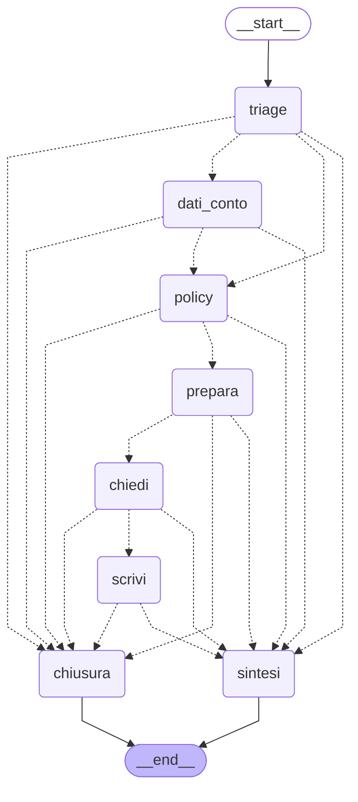

# Il grafo del supervisor

Generato da `scripts/disegna_grafo.py` dal grafo compilato: non è un disegno a mano.

## I percorsi

| instradamento | nodi |
|---|---|
| `dati_conto` | dati_conto |
| `policy` | policy |
| `entrambi` | dati_conto → policy |
| `segnalazione` | dati_conto → policy → prepara → chiedi → scrivi |
